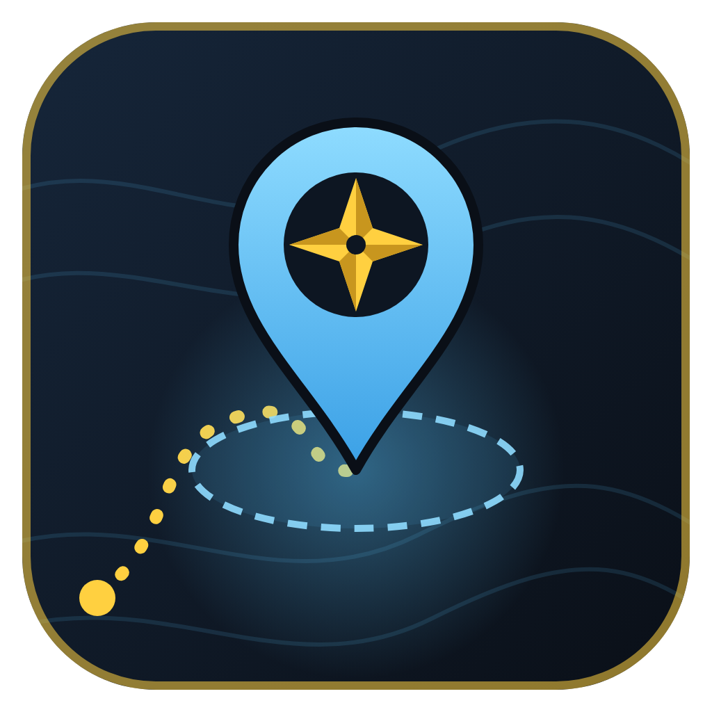

<p align="center"></p>

<h1 align="center">ExplorersMap</h1>

<p align="center">A pin on every area you still have to discover, zone by zone.<br>
For <b>World of Warcraft: Forever</b> · English and Spanish · works with OpenMap</p>

---

ExplorersMap knows every area that exploring reveals on each zone's map (569 areas across 44 zones, including Riverglades, Shen'dralas, Mount Hyjal and Zephras Isle), checks which ones your character has already found, and shows you the rest.

## Features

**Pins on the world map**
- A pin on every area you have not discovered yet. Discover it and the pin goes away on its own.
- Hover a pin for the area's name, its zone, its coordinates and the zone's progress.
- Click a pin to draw a 10 m circle round the spot. The pin is a guide: allow a margin of about 7 to 10 m.
- Works on Blizzard's world map and on [OpenMap](https://github.com/openmap-world/openmap)'s stitched map, where every zone's pins show at once.

**The window** (minimap button or `/emap`)
- **Progress:** how much of the world you have explored, by continent and by zone. Pick a zone to see the areas still to discover and the ones already found; click any of them to open the map there. The window opens on the zone you are standing in.
- **Guide:** the zones with areas left, sorted by how they suit your level and faction (explore now, with care, later), and the hardest and slowest zones to finish, with the reasons.
- **Settings:** language, pins on or off, pins only on zone maps, pin size, the minimap button, discovery announcements, and pin colours (one colour, by region, or by the zone's risk at your level).

**Discoveries**: the area's name shows on screen with the zone's count and your world percentage, and a line goes to chat.

## Install

Download the latest release (or this repository as a ZIP), and put the `ExplorersMap` folder in

```
World of Warcraft\_forever_\Interface\AddOns\
```

Restart the game. OpenMap is optional.

## Commands

| Command | What it does |
|---|---|
| `/emap` | opens or closes the window |
| `/emap pins` | shows or hides the map pins |
| `/emap help` | lists the commands |

## Languages

English (default) and Spanish, switched in **Settings**. Zone and area names are translated too.

To add a language, open the `Languages` folder: `eng.lua` explains it step by step, and `custom1.lua` to `custom3.lua` are free slots that need no other change. A text a language leaves out shows in English. Pull requests with new languages are welcome.

## Good to know

- Each pin sits at the centre of the piece of map that the area reveals. In areas with an odd shape the centre can be a little off: walk around the spot if the discovery does not trigger at once.
- The Guide's level ranges and faction ownership follow the Warcraft Wiki and the addon Zone Info: Forever. Which zones have elites near their areas is a judgment call based on the classic game.
- Cities and battlegrounds are not counted as zones of their own.

## Repository layout

| Path | What it is |
|---|---|
| `*.lua`, `ExplorersMap.toc`, `Languages/` | the addon itself |
| `Data.lua` | generated: every area, where it is on its zone's map, and its English and Spanish name |
| `ZoneInfo.lua` | zone levels and owners, for the Guide |
| `tools/` | the Python scripts that build `Data.lua` (see `tools/README.md`) |
| `tests/` | a stand-in for the game's API and a test that runs the addon against it |
| `media/` | the logo |

Run the tests with `pip install lupa`, then `python tests/test.py` (and `python tests/test.py 0` for the classic map art).

## Credits

- Map pieces: OpenMap's reveal data, built from the game's tables ([openmap-world/openmap](https://github.com/openmap-world/openmap), MIT).
- Area names in English and Spanish: [LibBabble-SubZone-3.0](https://github.com/arithmandar/LibBabble-SubZone-3.0) by Arith Hsu (MIT).
- Texture names: the community listfile ([wowdev/wow-listfile](https://github.com/wowdev/wow-listfile)).

Their licences are in `LICENSES/`.

World of Warcraft and its map data are the property of Blizzard Entertainment. ExplorersMap is a fan-made addon, not affiliated with or endorsed by Blizzard.
